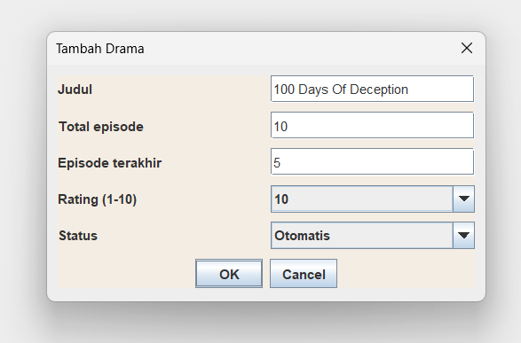
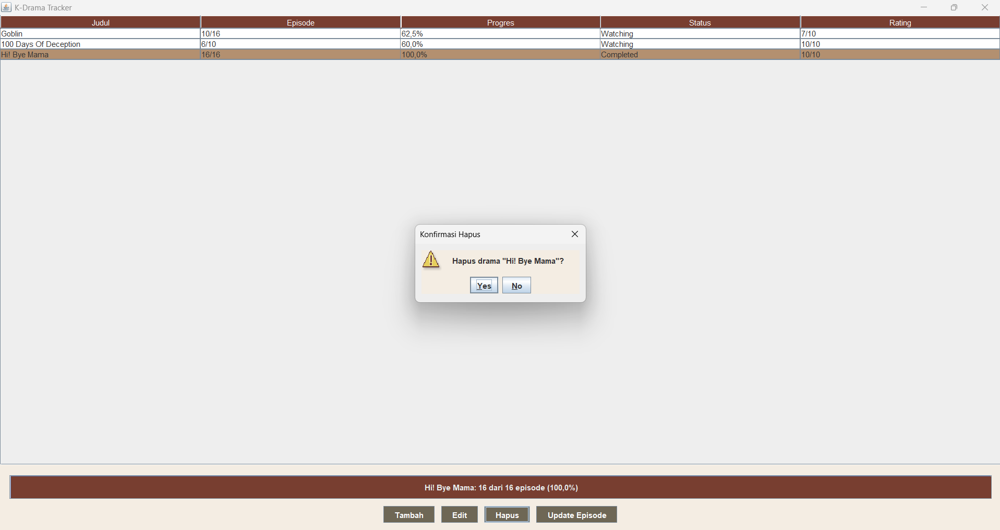
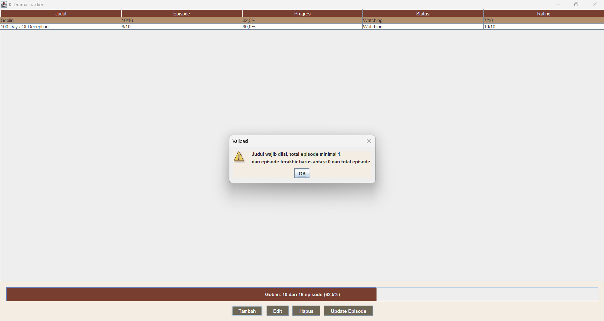
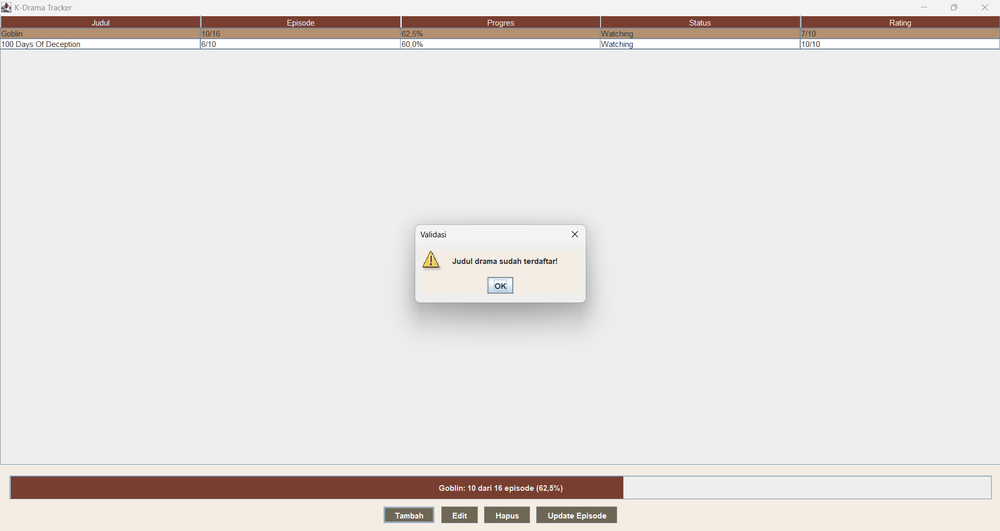

# K-Drama Tracker

K-Drama Tracker adalah aplikasi berbasis Java Swing untuk mencatat drama Korea dan memantau progres menonton. Aplikasi menyediakan fitur tambah, edit, hapus, update episode, dan rating drama.

## A. Fitur Aplikasi

- Menambah, mengedit, dan menghapus data drama.
- Memperbarui progres episode yang ditonton.
- Menghitung persentase progres secara otomatis.
- Menentukan status: Plan to Watch, Watching, Completed, dan Dropped.
- Memberikan rating drama dari skala 1 sampai 10.
- Memvalidasi judul drama agar data dengan judul yang sama tidak dapat ditambahkan atau disimpan saat diedit.

## B. Komponen GUI

### 1. Top-Level Container

`JFrame` digunakan sebagai wadah utama aplikasi K-Drama Tracker. Seluruh komponen GUI ditempatkan di dalam jendela ini agar pengguna dapat melihat dan berinteraksi dengan fitur aplikasi.

### 2. Intermediate Component

`JPanel` digunakan untuk mengelompokkan komponen GUI, seperti tombol operasi dan komponen formulir. Pengelompokan ini membuat susunan antarmuka lebih teratur dan memudahkan pengaturan tata letak.

### 3. Atomic Component

`JButton` digunakan untuk menjalankan aksi tambah, edit, hapus, dan update episode. `JLabel` menampilkan keterangan pada formulir, sedangkan `JTextField` menerima input judul dan jumlah episode. `JComboBox` digunakan untuk memilih rating dan status drama. `JTable` menampilkan daftar drama beserta progres, status, dan rating. `JProgressBar` menunjukkan progres episode drama yang dipilih. Sementara itu, `JOptionPane` digunakan untuk menampilkan formulir, pesan validasi, dan konfirmasi penghapusan.

## C. Layout Manager

`BorderLayout` digunakan untuk mengatur posisi tabel di bagian tengah jendela dan panel operasi di bagian bawah. `GridLayout` menyusun komponen formulir dalam baris dan kolom. Sementara itu, `FlowLayout` mengatur tombol operasi agar tersusun secara horizontal.

## D. Event Handling

Aplikasi menggunakan dua interface Java untuk menangani interaksi pengguna.

### 1. ActionListener

`ActionListener` digunakan untuk mendeteksi klik tombol. Interface ini diimplementasikan melalui method `actionPerformed()`, yang membedakan aksi berdasarkan tombol yang dipilih. Dengan demikian, pengguna dapat menambah, mengedit, menghapus, dan memperbarui progres episode drama.

### 2. ListSelectionListener

`ListSelectionListener` digunakan untuk mendeteksi perubahan pemilihan baris pada `JTable`. Interface ini diimplementasikan melalui method `valueChanged()`. Ketika pengguna memilih drama, aplikasi memperbarui `JProgressBar` sesuai jumlah episode yang telah ditonton.

## E. Perhitungan Progres

Progres episode dihitung menggunakan rumus:

`Progres = (Episode Ditonton / Total Episode) × 100%`

Sebagai contoh, jika pengguna telah menonton 10 dari total 16 episode, progresnya adalah 62,5%. Aplikasi juga menentukan status drama berdasarkan jumlah episode yang ditonton dan pilihan status Dropped.

## F. Penyimpanan Data

Data drama disimpan sementara menggunakan `ArrayList<Object[]>`. Struktur ini digunakan untuk menampung data selama aplikasi berjalan tanpa memerlukan database. Data dapat ditambah, diubah, dan dihapus, tetapi tidak akan tersimpan setelah aplikasi ditutup.

## G. Cara Menjalankan

Pastikan Java Development Kit (JDK) telah terpasang. Buka folder proyek di VS Code, kemudian buka `src/App.java` dan klik **Run** pada method `main()`.

Aplikasi juga dapat dijalankan melalui terminal dari folder utama proyek menggunakan perintah berikut:

```bash
javac -d out src/App.java
java -cp out App
```

## H. Screenshot

Tampilan Halaman Utama


Tampilan Tambah Drama Baru


Tampilan Edit Drama


Tampilan Hapus Drama


Tampilan Validasi Inputan Jumlah Episode


Tampilan Validasi Inputan Judul


Tampilan Validasi Duplikat Drama


