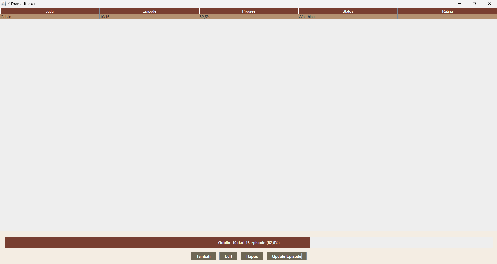
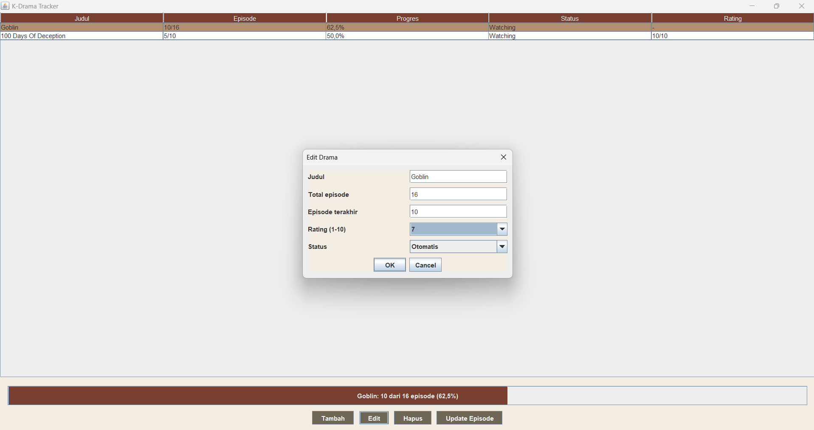
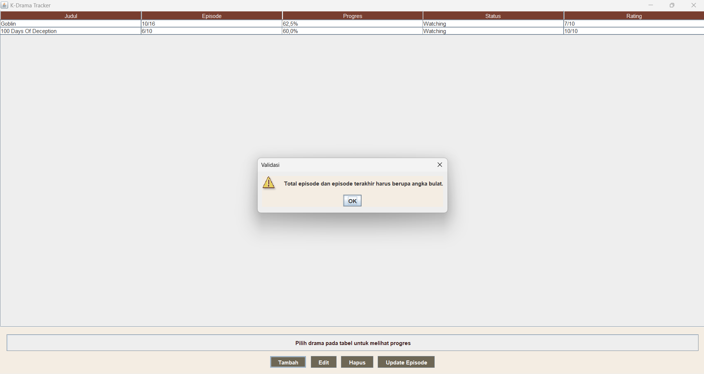

# K-Drama Tracker

K-Drama Tracker adalah aplikasi berbasis Java Swing untuk mencatat drama Korea dan memantau progres menonton. Aplikasi menyediakan fitur tambah, edit, hapus, update episode, dan rating drama.

## A. Fitur Aplikasi

- Menambah, mengedit, dan menghapus data drama.
- Memperbarui progres episode yang ditonton.
- Menghitung persentase progres secara otomatis.
- Menentukan status: Plan to Watch, Watching, Completed, dan Dropped.
- Memberikan rating drama dari skala 1 sampai 10.
- Memvalidasi input untuk memastikan data yang dimasukkan sesuai ketentuan.
- Mencegah penambahan atau pengubahan data dengan judul drama duplikat.

## B. Komponen GUI

### 1. Top-Level Container

`JFrame` digunakan sebagai wadah utama aplikasi K-Drama Tracker. Seluruh komponen GUI ditempatkan di dalam jendela ini agar pengguna dapat melihat dan berinteraksi dengan fitur aplikasi.

### 2. Intermediate Component

`JPanel` digunakan untuk mengelompokkan komponen GUI, seperti tombol operasi dan komponen formulir. Pengelompokan ini membuat susunan antarmuka lebih teratur dan memudahkan pengaturan tata letak.

### 3. Atomic Component

- **JButton:** Menjalankan aksi tambah, edit, hapus, dan update episode.
- **JLabel:** Menampilkan keterangan pada formulir.
- **JTextField:** Menerima input judul, total episode, dan episode terakhir yang ditonton.
- **JComboBox:** Menyediakan pilihan rating dan status drama.
- **JTable:** Menampilkan daftar drama beserta progres, status, dan rating.
- **JProgressBar:** Menunjukkan progres episode drama yang dipilih.
- **JOptionPane:** Menampilkan formulir, pesan validasi, dan konfirmasi penghapusan.
- **JScrollPane:** Menyediakan fasilitas gulir pada tabel jika data melebihi area tampilan.

## C. Layout Manager

Aplikasi menggunakan tiga layout manager untuk mengatur posisi komponen GUI.

- **BorderLayout:** Menempatkan tabel di bagian tengah jendela dan panel operasi di bagian bawah.
- **GridLayout:** Menyusun komponen formulir dalam baris dan kolom serta mengatur komponen pada panel bagian bawah.
- **FlowLayout:** Menyusun tombol operasi secara horizontal.

## D. Event Handling

Aplikasi menggunakan dua interface Java untuk menangani interaksi pengguna.

### 1. ActionListener

`ActionListener` digunakan untuk mendeteksi aksi pengguna pada tombol. Interface ini diimplementasikan melalui method `actionPerformed()`, yang membedakan aksi berdasarkan tombol yang dipilih. Method ini mengarahkan aplikasi untuk menambah, mengedit, menghapus, atau memperbarui progres episode drama.

### 2. ListSelectionListener

`ListSelectionListener` digunakan untuk mendeteksi perubahan pemilihan baris pada `JTable`. Interface ini diimplementasikan melalui method `valueChanged()`. Ketika pengguna memilih drama, aplikasi memperbarui `JProgressBar` sesuai jumlah episode yang telah ditonton.

## E. Perhitungan Progres dan Status

Persentase progres episode dihitung menggunakan rumus:

`Progres = (Episode Ditonton / Total Episode) × 100%`

Sebagai contoh, jika pengguna telah menonton 10 dari total 16 episode, progresnya adalah 62,5%.

Status drama ditentukan berdasarkan jumlah episode yang ditonton dan pilihan status Dropped dengan aturan berikut:

- **Completed:** Semua episode telah ditonton.
- **Dropped:** Drama belum selesai ditonton dan pengguna memilih status Dropped.
- **Watching:** Drama belum selesai dan pengguna telah menonton minimal satu episode.
- **Plan to Watch:** Pengguna belum menonton episode apa pun dan tidak memilih status Dropped.

## F. Penyimpanan Data

Data drama disimpan sementara menggunakan `ArrayList<Object[]>`. Setiap data drama memuat judul, total episode, episode terakhir yang ditonton, rating, dan pilihan status Dropped.

Struktur ini memungkinkan data ditambah, diubah, dan dihapus selama aplikasi berjalan tanpa memerlukan database. Namun, data tidak akan tersimpan setelah aplikasi ditutup.

## G. Validasi Data

Aplikasi melakukan validasi sebelum menyimpan atau memperbarui data drama.

- **Judul drama:** Tidak boleh kosong atau sama dengan judul drama lain. Pemeriksaan duplikasi tidak membedakan huruf besar dan kecil.
- **Total episode:** Harus berupa bilangan bulat minimal 1.
- **Episode terakhir:** Harus berupa bilangan bulat antara 0 dan total episode.
- **Format angka:** Jika total episode atau episode terakhir bukan bilangan bulat, aplikasi menampilkan pesan peringatan.
- **Penghapusan data:** Aplikasi meminta konfirmasi pengguna sebelum menghapus drama.

Jika input tidak valid, aplikasi menampilkan pesan peringatan dan meminta pengguna memperbaiki data sebelum melanjutkan.

## H. Algoritma Aplikasi

Alur kerja aplikasi K-Drama Tracker adalah sebagai berikut:

1. **Inisialisasi:** Aplikasi menampilkan jendela utama dan daftar drama awal.
2. **Tambah drama:** Pengguna mengisi formulir, kemudian aplikasi memvalidasi data dan memeriksa duplikasi judul sebelum menyimpannya.
3. **Edit drama:** Pengguna memilih drama dan mengubah datanya. Aplikasi memvalidasi perubahan sebelum menyimpan data terbaru.
4. **Hapus drama:** Pengguna memilih drama dan mengonfirmasi penghapusan.
5. **Update episode:** Pengguna memasukkan jumlah episode terakhir yang ditonton. Aplikasi memvalidasi angka dan memastikan nilainya tidak melebihi total episode.
6. **Hitung progres:** Aplikasi menghitung persentase episode yang telah ditonton berdasarkan total episode.
7. **Tentukan status:** Aplikasi menentukan status drama berdasarkan progres episode dan pilihan status Dropped.
8. **Perbarui tampilan:** Aplikasi memperbarui tabel dan menampilkan progres drama yang dipilih pada progress bar.

## I. Cara Menjalankan

Pastikan Java Development Kit (JDK) telah terpasang. Buka folder proyek di Visual Studio Code, kemudian buka `src/App.java` dan jalankan method `main()` menggunakan tombol **Run**.

Aplikasi juga dapat dijalankan melalui terminal dari folder utama proyek menggunakan perintah berikut:

```bash
javac -d out src/App.java
java -cp out App
```

## J. Screenshot

Tampilan Halaman Utama


Tampilan Tambah Drama Baru


Tampilan Edit Drama


Tampilan Hapus Drama


Tampilan Validasi Inputan Jumlah Episode


Tampilan Validasi Inputan Judul


Tampilan Validasi Duplikat Drama


